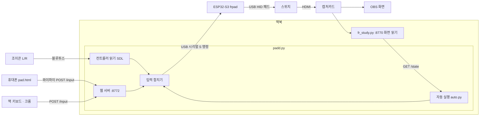

# auto — 스위치 파이어레드를 맥에서 조종하기

ESP32-S3 보드가 스위치에 **유선 컨트롤러(HORIPAD S)인 척** 꽂혀 있고, 맥이 그 보드에 USB 시리얼로
"지금 이 버튼을 누르고 있어"라고 알려준다. 조이콘이든 휴대폰이든 키보드든 자동 배틀이든,
**전부 맥에서 하나의 입력으로 합쳐져서 보드로 간다.** 그래서 스위치 입장에서는 컨트롤러가 늘 하나(1P)뿐이다.

## 전체 그림

```
                         ┌───────────────────────────── 맥북 ─────────────────────────────┐
  조이콘 L/R ── 블루투스 ─▶│  padd.py  (보드 연결을 붙잡고 있는 단 하나의 프로그램)                 │
                         │   ├─ 컨트롤러 읽기 (pygame/SDL, 2 ms마다)  ──┐                     │
  휴대폰 ── 와이파이 ─────▶│   ├─ 웹 서버 :8772  POST /input  ───────────┤ 입력 합치기          │
  (pad.html 터치 패드)     │   │                                        ├──▶ "S 4 8 128 0 …" ─┼─ USB 시리얼 ─▶ ESP32-S3
  맥 키보드 ─ 크롬 ───────▶│   │  (pad.html, 키를 누르는 동안 계속)      │    (응답 안 기다림)  │   (COM 포트)    (frpad 펌웨어)
                         │   └─ 자동 실행 (ZR/ZL/버튼)                 │                     │                    │
                         │        auto.py: 배틀·루트 ──────────────────┘ 자동 중 수동 입력=즉시 멈춤│              USB HID
                         │             ▲  화면 상태 GET /state                                 │                    ▼
                         │             │                                                     │            ┌──────────────┐
                         │  fr_study.py (run.sh) :8770  ◀── ffmpeg ◀── 캡처카드 ◀── HDMI ──────┼────────────│ 닌텐도 스위치 │
                         │   글자 인식·HP/PP 읽기 → /state, 번역 패널                            │            │ (보드 = 1P)   │
                         └───────────────────────────────────────────────────────────────────┘            └──────────────┘
                                         OBS 창으로 게임 화면을 본다 (캡처카드 → OBS)
```

<details><summary>같은 그림 (Mermaid)</summary>


</details>

## 각 부분이 하는 일

### 1. 보드 (ESP32-S3 + `frpad/frpad.ino`)
- USB(오른쪽 단자, 스위치 독에 연결)로는 **HORIPAD S 패드**라고 자기소개한다. HORI 제품 ID라서 스위치가
  프로콘처럼 복잡한 인증 없이 바로 받아준다. 8바이트 보고서: 버튼 16개, 십자키(hat), 스틱 4축.
- COM(왼쪽 단자, 맥에 연결)으로는 한 줄짜리 텍스트 명령을 받는다 (115200 baud).

  | 명령 | 뜻 |
  |---|---|
  | `?` | 살아있나 → `OK FRPAD 1` |
  | `S 버튼 hat lx ly rx ry` | 이 상태를 계속 누르고 있어 (예: `S 4 8 128 0 128 128` = A + 스틱 위) |
  | `P 버튼 hat ms` | ms 동안 눌렀다 떼 (보드가 시간 잼) |
  | `R` | 전부 떼 |

- 명령이 오면 바로 스위치로 보내고, 그 외에도 8 ms마다 같은 상태를 다시 보낸다.
- 10초 동안 명령이 없으면 스스로 손을 뗀다 (맥이 멈춰도 캐릭터가 계속 걷지 않게). 그래서 padd.py는
  누르고 있는 동안 2초마다 같은 명령을 다시 보낸다.

### 2. 파이어레드 쪽 사정 (왜 방향이 '스틱'인가)
- 이 게임은 **1P 입력만** 받는다. 그래서 보드를 1P로 등록해 두고, 조이콘은 스위치가 아니라 맥에 붙인다.
- 게임이 이 패드의 십자키를 버튼으로 읽는다 (위=START, 왼쪽=SELECT, 오른쪽=A, 아래=B).
  그래서 **이동은 항상 왼쪽 스틱으로** 보내고, GBA의 SELECT(배틀서처)는 십자키 왼쪽으로 보낸다.

### 3. padd.py — 입력을 모으는 곳 (`python padd.py`)
보드의 시리얼 포트는 한 프로그램만 열 수 있어서, padd.py 하나가 계속 붙잡고 모든 입력을 받는다.

- **조이콘**: pygame(SDL)이 맥에 블루투스로 붙은 컨트롤러를 2 ms마다 읽는다.
  - `SDL_JOYSTICK_HIDAPI_COMBINE_JOY_CONS`: 왼쪽+오른쪽 조이콘을 한 컨트롤러로 합친다.
  - `SDL_JOYSTICK_ALLOW_BACKGROUND_EVENTS`: OBS 창을 보고 있어도(다른 앱이 앞에 있어도) 계속 읽는다.
  - macOS App Nap 끄기: 뒤에 있는 앱은 맥이 타이머를 몰아서 늦게 깨운다. 게임처럼 "지연에 민감한 작업"으로
    등록해서 막는다.
- **휴대폰·키보드**: 같은 프로그램이 웹 서버(포트 8772)를 띄우고 `pad.html`을 준다.
  - 휴대폰은 터치 십자키/버튼을 누르는 순간·떼는 순간 `POST /input {b:[버튼], lx, ly}`를 보낸다.
  - 맥 크롬에서는 키를 누르는 순간·떼는 순간 이벤트가 오므로, 누르고 있는 동안 계속 걷는다.
    (터미널의 drive.py는 '뗐다'를 알 수 없어서 키 반복에 기대야 했고, 그래서 끊겼다.)
  - 같은 와이파이의 다른 기기가 못 쓰게, 맥이 아닌 곳에서는 주소에 `?k=비밀번호`(pad_token.txt)가 있어야 한다.
- **합치기**: 여러 입력의 버튼은 OR, 스틱은 먼저 움직인 쪽. 상태가 바뀔 때만 `S …` 한 줄을 보낸다.
  보드의 `OK` 답은 기다리지 않는다 (기다리면 변화마다 수 ms씩 밀렸다).
- **자동 실행**: ZR = 자동 배틀, ZL = 충전 루트, 페이지 버튼 = 온천 / 재대결 루프.
  auto.py의 자동 조종을 같은 프로그램 안에서 같은 보드로 돌린다. 자동 중에 스틱이나 버튼을 건드리면
  즉시 멈추고(다음 동작 전에 확인) 손으로 하던 입력이 바로 들어간다.

### 4. auto.py — 자동 조종의 머리
- `fr_study.py`(run.sh)가 캡처 화면을 매 프레임 분석해서 `http://127.0.0.1:8770/state`로 알려준다:
  대화창이 있는지, 빨간 ▼가 있는지, 글자(대사·메뉴·기술 목록), HP 칸(이름·레벨), PP 칸, 화면 밝기.
- auto.py는 그걸 보고 판단한다:
  - 배틀: 메뉴 → 싸운다 → `battle_ai.py`가 타입 상성·위력·자속으로 기술과 대상을 고름 → 기술 칸 이동 → A.
    PP 0이면 그 기술을 기억해서 다른 기술. 기술 배우기·기절·눈앞이 깜깜 같은 건 멈추고 알림.
  - 루트: `routes/*.txt`를 한 줄씩 실행 (아래 표). 걷기는 칸 수 × 16프레임(달리기 8프레임)만큼 스틱을 민다.
    문·동굴은 화면이 어두워졌다 밝아지는 걸 보고 기다린다.

### 5. 다른 파일

| 파일 | 하는 일 |
|---|---|
| `pad.py` | 보드와 대화하는 라이브러리 (포트 찾기, `press`/`walk`/`hold`, 방향→스틱 변환) |
| `padd.py`, `pad.html` | 위 3번: 조이콘·휴대폰·키보드 + 자동 실행 |
| `auto.py` | 위 4번. 단독 실행도 됨: `python auto.py battle`, `python auto.py route routes/loop.txt --loop 20` |
| `battle_ai.py`, `data/gen3.json` | 3세대 기술·포켓몬·상성 데이터로 기술 고르기 |
| `drive.py` | 예전 터미널 키보드 조종 (+녹화 `--record`). 이제는 padd.py 추천 |
| `padcheck.py` | 보드 버튼 테스트 (`--home`: 홈 메뉴용 십자키) |
| `test_sim.py` | 화면 없이 배틀 판단을 흉내 내는 테스트 |
| `frpad/` | 보드 펌웨어 소스와 굽는 파일(`frpad.merged.bin`) |
| `routes/` | 루트 파일: `charge.txt` 배틀서처 충전, `onsen.txt` 온천 왕복, `loop.txt` 재대결 루프 |

## 실행 순서

```
# 터미널 1: 화면 읽기 (자동 배틀에 필요). 번역까지 보려면 --no-llm 빼기
cd pixel-sensei && ./run.sh --no-llm

# 터미널 2: 패드 서버
cd pixel-sensei/auto && python padd.py
#   맥: http://127.0.0.1:8772   휴대폰: http://<맥 IP>:8772/?k=<비밀번호>
```
- 보드: COM 단자 → 맥, USB 단자 → 스위치 독. 스위치 "컨트롤러 → 그립/순서 변경"에서 보드가 1P.
- 조이콘: 옆면 동기화 버튼 1초 → 맥 블루투스에서 연결. 다시 스위치에 쓰려면 본체에 끼우면 된다.
- padd.py가 켜져 있는 동안 drive.py / auto.py를 따로 켜지 않는다 (포트는 하나).

## 조작

| 조이콘 | 키보드 (pad.html) | 동작 |
|---|---|---|
| 왼쪽 스틱 / 십자키 | ← ↑ ↓ → / WASD | 이동 |
| A B X Y | J K U I | 같은 버튼 |
| L R | L ; | 같은 버튼 |
| + | Enter | START |
| − | \ | SELECT (배틀서처) |
| ZR | B | 자동 배틀 (실행 중이면 멈춤) |
| ZL | C | 충전 루트 |

## 루트 파일 명령 (`routes/*.txt`)

| 명령 | 뜻 |
|---|---|
| `walk UP 3 [run] [door] / door=K` | 이동. door = 중간에 문/동굴(화면 전환). K칸째에서 전환되면 door=K가 가장 빠름 |
| `face LEFT` | 제자리에서 돌기 |
| `talk LEFT 3` | 그쪽을 보고 A — 재대결이면 싸우고, 아니면 대사 닫고 다음으로 |
| `seeker` | SELECT로 배틀서처 사용, 연출 끝까지 기다림 (충전 안 됐으면 멈춤) |
| `pace UP 4 len=11 run` | 왔다 갔다 (충전 걸음 수 채우기) |
| `press A [ms] [쉬는 초]` | 버튼 |
| `until_free` / `battle` | 대화 넘기기 / 배틀 하나 끝까지 |
| `include charge.txt` | 다른 루트 파일 끼워 넣기 |

## 지연(latency) 어디서 생기나

| 구간 | 대략 |
|---|---|
| 조이콘 → 맥 (블루투스) | 15–30 ms |
| padd.py (읽기 2 ms + 시리얼 쓰기) | 수 ms |
| 보드 → 스위치 (USB) | 1–8 ms |
| 게임 자체 (에뮬레이터, 프레임) | ~50 ms |
| 캡처카드 → OBS 화면 | **100–200 ms** (제일 큼) |

화면 지연을 줄이려면 캡처카드의 HDMI 출력(패스스루)에 모니터를 연결해서 그 화면을 보고 한다.
